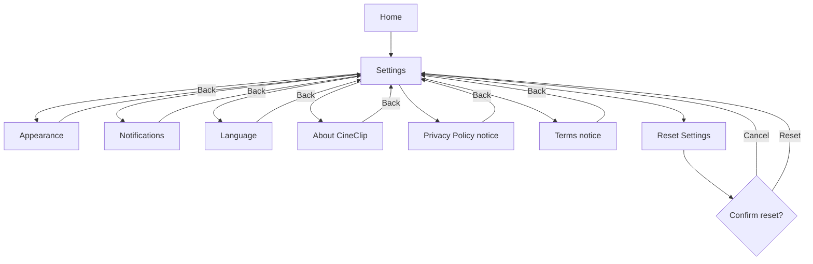

# CineClip Settings

## Current implementation

The Home gear button opens a Settings screen. Its options and current limitations are:

1. Appearance
   - System Default, Dark, and Light themes are available.
   - Selection is applied app-wide and saved in SharedPreferences as `settings_theme_mode`.
2. Notifications
   - The master switch and Export completed, Export failed, and App tips and updates switches are saved in SharedPreferences.
   - Defaults are On, On, On, and Off respectively.
   - Notification delivery and OS permission handling are not implemented yet; the screen states this.
3. Language
   - English is the only supported language. Other languages are not offered until translations are available.
4. About CineClip
   - Shows the app name, tagline, version `1.0.0`, and a description that identifies video creation/export as prototype features.
5. Privacy Policy
   - Opens an explicit not-yet-provided notice. No policy claims are fabricated.
6. Terms and Conditions
   - Opens an explicit not-yet-provided notice. Approved legal terms must be supplied before publication.
7. Reset Settings to Default
   - Requires confirmation, restores appearance and notification preferences, and does not clear the onboarding-completed preference or user media.
   - Shows `Settings restored to default.` after success.

The Settings screen uses Material 3 styling and returns to Home through normal Back navigation. The Home screen supports System Default, Dark, and Light appearance modes.

## Settings flow

## Implementation checklist

- [x] Replace the placeholder dialog with a Settings page opened from the Home gear icon.
- [x] Implement the seven options in the order listed above, with honest notices for legal content not yet supplied.
- [x] Persist theme and notification preferences and apply the theme on app restart.
- [x] Confirm resets and preserve onboarding completion and user media.
- [ ] Implement notification delivery and request OS permission when notifications are supported.
- [ ] Add approved privacy policy and terms content or official URLs.
- [ ] Add translations before offering additional languages.
- [ ] Read the app version from build metadata rather than the current `1.0.0` display value.
